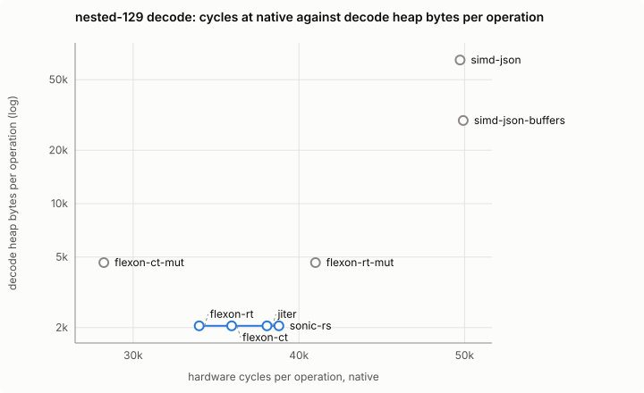
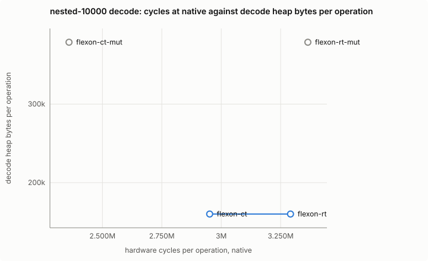

# Results

Generated by `cargo xtask report` from `results/`; do not edit. `cargo xtask report --check` fails when this file, the figures or `verdict.json` differ from what `results/` generates. The method is in the [repository README](../README.md), and so is the commentary.

> **Stale.** Rendered with `--allow-stale`: these results were not all measured on the committed code, so nothing below is evidence.
>
> - callgrind/x86_64.json: measured on code without a fingerprint (HEAD is 1bc91eea6374c3be)
> - callgrind/e2e-x86_64.json: measured on code without a fingerprint (HEAD is 1bc91eea6374c3be)
> - x86_64-linux-amd-ryzen-7-7800x3d-8-core-processor/e2e-time.json: measured on code without a fingerprint (HEAD is 1bc91eea6374c3be)
> - x86_64-linux-amd-ryzen-7-7800x3d-8-core-processor/conformance/portable/baseline.json: measured on code without a fingerprint (HEAD is 1bc91eea6374c3be)
> - x86_64-linux-amd-ryzen-7-7800x3d-8-core-processor/conformance/portable/baseline+arbitrary-precision.json: measured on code without a fingerprint (HEAD is 1bc91eea6374c3be)
> - x86_64-linux-amd-ryzen-7-7800x3d-8-core-processor/conformance/portable/baseline-float-roundtrip.json: measured on code without a fingerprint (HEAD is 1bc91eea6374c3be)
> - x86_64-linux-amd-ryzen-7-7800x3d-8-core-processor/conformance/portable/baseline-float-roundtrip+arbitrary-precision.json: measured on code without a fingerprint (HEAD is 1bc91eea6374c3be)
> - x86_64-linux-amd-ryzen-7-7800x3d-8-core-processor/conformance/portable/sonic-rs.json: measured on code without a fingerprint (HEAD is 1bc91eea6374c3be)
> - x86_64-linux-amd-ryzen-7-7800x3d-8-core-processor/conformance/portable/sonic-rs+arbitrary-precision.json: measured on code without a fingerprint (HEAD is 1bc91eea6374c3be)
> - x86_64-linux-amd-ryzen-7-7800x3d-8-core-processor/conformance/portable/simd-json.json: measured on code without a fingerprint (HEAD is 1bc91eea6374c3be)
> - x86_64-linux-amd-ryzen-7-7800x3d-8-core-processor/conformance/portable/simd-json+arbitrary-precision.json: measured on code without a fingerprint (HEAD is 1bc91eea6374c3be)
> - x86_64-linux-amd-ryzen-7-7800x3d-8-core-processor/conformance/portable/flexon-rt.json: measured on code without a fingerprint (HEAD is 1bc91eea6374c3be)
> - x86_64-linux-amd-ryzen-7-7800x3d-8-core-processor/conformance/portable/flexon-rt+arbitrary-precision.json: measured on code without a fingerprint (HEAD is 1bc91eea6374c3be)
> - x86_64-linux-amd-ryzen-7-7800x3d-8-core-processor/conformance/portable/flexon-ct.json: measured on code without a fingerprint (HEAD is 1bc91eea6374c3be)
> - x86_64-linux-amd-ryzen-7-7800x3d-8-core-processor/conformance/portable/flexon-ct+arbitrary-precision.json: measured on code without a fingerprint (HEAD is 1bc91eea6374c3be)
> - x86_64-linux-amd-ryzen-7-7800x3d-8-core-processor/conformance/portable/jiter.json: measured on code without a fingerprint (HEAD is 1bc91eea6374c3be)
> - x86_64-linux-amd-ryzen-7-7800x3d-8-core-processor/conformance/portable/jiter+arbitrary-precision.json: measured on code without a fingerprint (HEAD is 1bc91eea6374c3be)
> - x86_64-linux-amd-ryzen-7-7800x3d-8-core-processor/conformance/portable/hifijson.json: measured on code without a fingerprint (HEAD is 1bc91eea6374c3be)
> - x86_64-linux-amd-ryzen-7-7800x3d-8-core-processor/conformance/portable/hifijson+arbitrary-precision.json: measured on code without a fingerprint (HEAD is 1bc91eea6374c3be)
> - x86_64-linux-amd-ryzen-7-7800x3d-8-core-processor/conformance/portable/struson.json: measured on code without a fingerprint (HEAD is 1bc91eea6374c3be)
> - x86_64-linux-amd-ryzen-7-7800x3d-8-core-processor/conformance/portable/struson+arbitrary-precision.json: measured on code without a fingerprint (HEAD is 1bc91eea6374c3be)
> - x86_64-linux-amd-ryzen-7-7800x3d-8-core-processor/conformance/v3/baseline.json: measured on code without a fingerprint (HEAD is 1bc91eea6374c3be)
> - x86_64-linux-amd-ryzen-7-7800x3d-8-core-processor/conformance/v3/baseline-float-roundtrip.json: measured on code without a fingerprint (HEAD is 1bc91eea6374c3be)
> - x86_64-linux-amd-ryzen-7-7800x3d-8-core-processor/conformance/v3/sonic-rs.json: measured on code without a fingerprint (HEAD is 1bc91eea6374c3be)
> - x86_64-linux-amd-ryzen-7-7800x3d-8-core-processor/conformance/v3/simd-json.json: measured on code without a fingerprint (HEAD is 1bc91eea6374c3be)
> - x86_64-linux-amd-ryzen-7-7800x3d-8-core-processor/conformance/v3/flexon-rt.json: measured on code without a fingerprint (HEAD is 1bc91eea6374c3be)
> - x86_64-linux-amd-ryzen-7-7800x3d-8-core-processor/conformance/v3/flexon-ct.json: measured on code without a fingerprint (HEAD is 1bc91eea6374c3be)
> - x86_64-linux-amd-ryzen-7-7800x3d-8-core-processor/conformance/v3/jiter.json: measured on code without a fingerprint (HEAD is 1bc91eea6374c3be)
> - x86_64-linux-amd-ryzen-7-7800x3d-8-core-processor/conformance/v3/hifijson.json: measured on code without a fingerprint (HEAD is 1bc91eea6374c3be)
> - x86_64-linux-amd-ryzen-7-7800x3d-8-core-processor/conformance/v3/struson.json: measured on code without a fingerprint (HEAD is 1bc91eea6374c3be)
> - x86_64-linux-amd-ryzen-7-7800x3d-8-core-processor/conformance/native/baseline.json: measured on code without a fingerprint (HEAD is 1bc91eea6374c3be)
> - x86_64-linux-amd-ryzen-7-7800x3d-8-core-processor/conformance/native/baseline-float-roundtrip.json: measured on code without a fingerprint (HEAD is 1bc91eea6374c3be)
> - x86_64-linux-amd-ryzen-7-7800x3d-8-core-processor/conformance/native/sonic-rs.json: measured on code without a fingerprint (HEAD is 1bc91eea6374c3be)
> - x86_64-linux-amd-ryzen-7-7800x3d-8-core-processor/conformance/native/simd-json.json: measured on code without a fingerprint (HEAD is 1bc91eea6374c3be)
> - x86_64-linux-amd-ryzen-7-7800x3d-8-core-processor/conformance/native/flexon-rt.json: measured on code without a fingerprint (HEAD is 1bc91eea6374c3be)
> - x86_64-linux-amd-ryzen-7-7800x3d-8-core-processor/conformance/native/flexon-ct.json: measured on code without a fingerprint (HEAD is 1bc91eea6374c3be)
> - x86_64-linux-amd-ryzen-7-7800x3d-8-core-processor/conformance/native/jiter.json: measured on code without a fingerprint (HEAD is 1bc91eea6374c3be)
> - x86_64-linux-amd-ryzen-7-7800x3d-8-core-processor/conformance/native/hifijson.json: measured on code without a fingerprint (HEAD is 1bc91eea6374c3be)
> - x86_64-linux-amd-ryzen-7-7800x3d-8-core-processor/conformance/native/struson.json: measured on code without a fingerprint (HEAD is 1bc91eea6374c3be)
> - x86_64-linux-amd-ryzen-7-7800x3d-8-core-processor/alloc.json: measured on code without a fingerprint (HEAD is 1bc91eea6374c3be)
> - x86_64-linux-amd-ryzen-7-7800x3d-8-core-processor/hw.json: measured on code without a fingerprint (HEAD is 1bc91eea6374c3be)
> - x86_64-linux-amd-ryzen-7-7800x3d-8-core-processor/time.json: measured on code without a fingerprint (HEAD is 1bc91eea6374c3be)
> - x86_64-linux-amd-ryzen-7-7800x3d-8-core-processor/size.json: measured on code without a fingerprint (HEAD is 1bc91eea6374c3be)
> - x86_64-linux-amd-ryzen-7-7800x3d-8-core-processor/compile-time.json: measured on code without a fingerprint (HEAD is 1bc91eea6374c3be)
> - x86_64-linux-amd-ryzen-7-7800x3d-8-core-processor/msrv.json: measured on code without a fingerprint (HEAD is 1bc91eea6374c3be)
> - x86_64-linux-amd-ryzen-7-7800x3d-8-core-processor/doctor.json: measured on code without a fingerprint (HEAD is 1bc91eea6374c3be)
> - footprint.json: measured on code without a fingerprint (HEAD is 1bc91eea6374c3be)
> - fuzz.json: measured from a dirty checkout
> - miri.json: measured on code without a fingerprint (HEAD is 1bc91eea6374c3be)
> - hw.json: 144 rows missing (first: native serde_json#aa json-small decode owned shared)

## Verdict

| Entry point | Crate | Add to Kynos? | Deserves to exist? | Why |
| --- | --- | --- | --- | --- |
| `serde_json` | serde_json | baseline | yes — the baseline | all four rules hold |
| `serde_json+float_roundtrip` | serde_json | ❌ fail | yes — Correctly rounded float parsing, which the default parser is not (see conformance, numbers). | not on the frontier with a CPU or heap win beyond ε and the A/A band, corroborated at v3, on any Kynos shape |
| `sonic-rs` | sonic-rs | ❌ fail | yes — unicode encode heap 0.60× serde_json at native. Lazy path lookups without a full parse (`get`, `get_many`, `LazyValue`); errors carry a byte offset as well as line and column. | not on the frontier with a CPU or heap win beyond ε and the A/A band, corroborated at v3, on any Kynos shape |
| `simd-json` | simd-json | ❌ fail | yes — sweep-4kib encode heap 0.54× serde_json at native. Borrowing decode of escaped strings, unescaped in place: 1,175 allocations against serde_json's 4,584 for twitter-like into borrowed types from a unique buffer. A tape API (`to_tape`) traverses without building values. | not on the frontier with a CPU or heap win beyond ε and the A/A band, corroborated at v3, on any Kynos shape |
| `simd-json-buffers` | simd-json | ❌ fail | yes — sweep-4kib encode heap 0.54× serde_json at native. Reusing `Buffers` across calls roughly halves plain `from_slice`'s allocated bytes: 2.93 MB against 5.54 MB for twitter-like into borrowed types from a unique buffer. | not on the frontier with a CPU or heap win beyond ε and the A/A band, corroborated at v3, on any Kynos shape |
| `flexon-rt` | flexon | ❌ fail | yes — sweep-64b encode heap 0.50× serde_json at native. `from_mut_slice` borrows escaped strings in place; JSON-pointer access. Its latest release (0.4.9) does not compile on stable Rust. | not on the frontier with a CPU or heap win beyond ε and the A/A band, corroborated at v3, on any Kynos shape |
| `flexon-rt-mut` | flexon | ❌ fail | yes — sweep-64b encode heap 0.50× serde_json at native. In-place parse lets escaped strings borrow: 1,170 allocations and 558 kB against `flexon-rt`'s 4,583 and 749 kB for twitter-like into borrowed types from a unique buffer. | not on the frontier with a CPU or heap win beyond ε and the A/A band, corroborated at v3, on any Kynos shape |
| `flexon-ct` | flexon | ❌ fail | yes — sweep-64b encode heap 0.50× serde_json at native. The compile-time SIMD configuration of flexon; same API as `flexon-rt`. | not on the frontier with a CPU or heap win beyond ε and the A/A band, corroborated at v3, on any Kynos shape |
| `flexon-ct-mut` | flexon | ❌ fail | yes — sweep-64b encode heap 0.50× serde_json at native. In-place parse lets escaped strings borrow: 1,170 allocations and 558 kB against `flexon-ct`'s 4,583 and 749 kB for twitter-like into borrowed types from a unique buffer. | not on the frontier with a CPU or heap win beyond ε and the A/A band, corroborated at v3, on any Kynos shape |
| `jiter` | jiter | ❌ fail | yes — Partial mode parses truncated documents (built for streamed model output); decode only. | not on the frontier with a CPU or heap win beyond ε and the A/A band, corroborated at v3, on any Kynos shape |
| `hifijson` | hifijson | ❌ fail | yes — No `unsafe`: 0 unsafe blocks, functions or impls in its 1 runtime crate. Lexes any byte iterator (`IterLexer`), so input need not be in memory; numbers kept as text. | reference point: no borrowed slice decode plus `to_vec`-style encoder |
| `struson` | struson | ❌ fail | yes — sweep-64b encode heap 0.70× serde_json at native. No `unsafe`: 0 unsafe blocks, functions or impls across its 5 runtime crates. A true streaming reader and writer with JSON-path seeking and positions in errors. | reference point: no borrowed slice decode plus `to_vec`-style encoder |

## The decision rule, entry by entry

| Entry point | 1 Frontier | 2 Conformance | 3 Soundness | 4 End to end |
| --- | --- | --- | --- | --- |
| `sonic-rs` | ❌ not on the frontier with a CPU or heap win beyond ε and the A/A band, corroborated at v3, on any Kynos shape | ❌ grammar n_string_invalid_unicode_escape.json#ignored/owned#unique fails 4 of 4 conformance runs; fuzz decode_struct (portable); fuzz decode_struct (v3) | ✅ no advisory at advisory-db e2111519 | ❌ no route ≥10 % better in throughput or p99 beyond the A/A band |
| `simd-json` | ❌ not on the frontier with a CPU or heap win beyond ε and the A/A band, corroborated at v3, on any Kynos shape | ❌ status shape/variant-wrong-type fails 4 of 4 conformance runs; fuzz decode_struct (v3); fuzz decode_value (v3) | ✅ no advisory at advisory-db e2111519 | ⏳ provisional pass: echo-post +13 % rps, +66 % p99 on x86_64-linux-amd-ryzen-7-7800x3d-8-core-processor (solo); awaits a quiet-host rerun |
| `simd-json-buffers` | ❌ not on the frontier with a CPU or heap win beyond ε and the A/A band, corroborated at v3, on any Kynos shape | ❌ status shape/variant-wrong-type fails 4 of 4 conformance runs; fuzz decode_struct (v3); fuzz decode_value (v3) | ✅ no advisory at advisory-db e2111519 | ⏳ provisional pass: echo-post -16 % rps, +65 % p99 on x86_64-linux-amd-ryzen-7-7800x3d-8-core-processor (solo); awaits a quiet-host rerun |
| `flexon-rt` | ❌ not on the frontier with a CPU or heap win beyond ε and the A/A band, corroborated at v3, on any Kynos shape | ❌ grammar n_array_comma_after_close.json#value/owned#unique fails 4 of 4 conformance runs; Miri reports undefined behavior (in-bounds pointer arithmetic failed); fuzz decode_struct (v3); 1 more fuzz divergence | ✅ no advisory at advisory-db e2111519 | ❌ gains inconsistent with counted codec share: x86_64-linux-amd-ryzen-7-7800x3d-8-core-processor json-large-post: +59 % measured, +30 % predicted |
| `flexon-rt-mut` | ❌ not on the frontier with a CPU or heap win beyond ε and the A/A band, corroborated at v3, on any Kynos shape | ❌ grammar n_array_comma_after_close.json#value/owned#unique fails 4 of 4 conformance runs; Miri reports undefined behavior (in-bounds pointer arithmetic failed); fuzz decode_struct (v3); 1 more fuzz divergence | ✅ no advisory at advisory-db e2111519 | ⏳ provisional pass: echo-post +8 % rps, +85 % p99 on x86_64-linux-amd-ryzen-7-7800x3d-8-core-processor (solo); awaits a quiet-host rerun |
| `flexon-ct` | ❌ not on the frontier with a CPU or heap win beyond ε and the A/A band, corroborated at v3, on any Kynos shape | ❌ grammar n_array_comma_after_close.json#value/owned#unique fails 4 of 4 conformance runs; Miri reports undefined behavior (in-bounds pointer arithmetic failed); fuzz decode_struct (v3); 1 more fuzz divergence | ✅ no advisory at advisory-db e2111519 | ❌ no route ≥10 % better in throughput or p99 beyond the A/A band |
| `flexon-ct-mut` | ❌ not on the frontier with a CPU or heap win beyond ε and the A/A band, corroborated at v3, on any Kynos shape | ❌ grammar n_array_comma_after_close.json#value/owned#unique fails 4 of 4 conformance runs; Miri reports undefined behavior (in-bounds pointer arithmetic failed); fuzz decode_struct (v3); 1 more fuzz divergence | ✅ no advisory at advisory-db e2111519 | ⏳ provisional pass: json-large-post +52 % rps, +42 % p99 on x86_64-linux-amd-ryzen-7-7800x3d-8-core-processor (solo); awaits a quiet-host rerun |
| `jiter` | ❌ not on the frontier with a CPU or heap win beyond ε and the A/A band, corroborated at v3, on any Kynos shape | ❌ status shape/variant-wrong-type fails 4 of 4 conformance runs; fuzz decode_struct (v3); fuzz decode_value (v3); 1 more fuzz divergence | ✅ no advisory at advisory-db e2111519 | ❌ no route ≥10 % better in throughput or p99 beyond the A/A band |
| `hifijson` | ❌ not on the frontier with a CPU or heap win beyond ε and the A/A band, corroborated at v3, on any Kynos shape | ❌ status shape/valid fails 4 of 4 conformance runs; fuzz decode_struct (v3); fuzz decode_value (v3) | ✅ no advisory at advisory-db e2111519 | ❌ no route ≥10 % better in throughput or p99 beyond the A/A band |
| `struson` | ❌ not on the frontier with a CPU or heap win beyond ε and the A/A band, corroborated at v3, on any Kynos shape | ❌ status shape/variant-wrong-type fails 4 of 4 conformance runs; fuzz decode_struct (v3); fuzz decode_value (v3); 1 more fuzz divergence | ✅ no advisory at advisory-db e2111519 | ❌ no route ≥10 % better in throughput or p99 beyond the A/A band |

## CPU per operation at the Kynos shapes: decode

serde_json is the absolute figure; every other column is a ratio to it (below 1 is faster). Owned decode of one shared frame, and `to_vec` encode: what a server does. The rule reads `native (cycles)`, hardware cycles, with the A/A column (serde_json's second copy) as its noise floor; `v3 (est. cycles)` is callgrind's deterministic count, which corroborates it. The instruction rows are the same builds counted as instructions.

| Workload | Point | serde_json | A/A | `serde_json+float_roundtrip` | `sonic-rs` | `simd-json` | `simd-json-buffers` | `flexon-rt` | `flexon-rt-mut` | `flexon-ct` | `flexon-ct-mut` | `jiter` | `hifijson` | `struson` |
| --- | --- | --- | --- | --- | --- | --- | --- | --- | --- | --- | --- | --- | --- | --- |
| json-small | native (cycles) | 1633 | — | 0.65× | 0.71× | 0.83× | 0.86× | 0.68× | 0.72× | 0.65× | 0.44× | 0.62× | 0.71× | 2.55× |
| json-small | native (instructions) | 3802 | — | 1.01× | 0.82× | 1.27× | 0.85× | 0.71× | 0.72× | 0.71× | 0.72× | 0.89× | 1.19× | 3.68× |
| json-small | v3 (est. cycles) | 4040 | exact | 1.01× | 0.84× | 1.30× | 0.88× | 0.73× | 0.76× | 0.72× | 0.75× | 0.90× | 1.17× | 3.65× |
| json-small | v3 (Ir) | 4040 | exact | 1.01× | 0.83× | 1.30× | 0.88× | 0.73× | 0.76× | 0.72× | 0.75× | 0.90× | 1.17× | 3.65× |
| echo-post | native (cycles) | 1628 | — | 0.60× | 0.58× | 1.22× | 0.85× | 0.52× | 0.63× | 0.48× | 0.42× | 0.59× | 1.83× | 10.14× |
| echo-post | native (instructions) | 4368 | — | 1.01× | 0.58× | 1.74× | 1.05× | 0.46× | 0.54× | 0.45× | 0.53× | 0.48× | 3.06× | 14.76× |
| echo-post | v3 (est. cycles) | 4471 | exact | 1.02× | 0.60× | 1.87× | 1.19× | 0.51× | 0.63× | 0.51× | 0.62× | 0.53× | 3.01× | 14.57× |
| echo-post | v3 (Ir) | 4471 | exact | 1.02× | 0.60× | 1.87× | 1.19× | 0.51× | 0.63× | 0.51× | 0.62× | 0.53× | 3.01× | 14.57× |
| json-large | native (cycles) | 1.52 M | — | 0.67× | 0.56× | 0.60× | 0.71× | 0.71× | 0.61× | 0.68× | 0.40× | 0.68× | 0.73× | 2.27× |
| json-large | native (instructions) | 3.65 M | — | 1.01× | 0.79× | 0.77× | 0.77× | 0.75× | 0.73× | 0.73× | 0.72× | 0.91× | 1.14× | 2.95× |
| json-large | v3 (est. cycles) | 3.88 M | exact | 1.01× | 0.81× | 0.83× | 0.82× | 0.77× | 0.77× | 0.75× | 0.76× | 0.92× | 1.12× | 2.94× |
| json-large | v3 (Ir) | 3.82 M | exact | 1.01× | 0.80× | 0.81× | 0.79× | 0.76× | 0.76× | 0.74× | 0.75× | 0.92× | 1.12× | 2.97× |

## CPU per operation at the Kynos shapes: encode

| Workload | Point | serde_json | A/A | `serde_json+float_roundtrip` | `sonic-rs` | `simd-json` | `simd-json-buffers` | `flexon-rt` | `flexon-rt-mut` | `flexon-ct` | `flexon-ct-mut` | `struson` |
| --- | --- | --- | --- | --- | --- | --- | --- | --- | --- | --- | --- | --- |
| json-small | native (cycles) | 793 | — | 0.72× | 0.86× | 0.81× | 0.79× | 1.64× | 1.51× | 1.65× | 1.02× | 2.71× |
| json-small | native (instructions) | 1685 | — | 1.00× | 1.32× | 1.47× | 1.47× | 1.84× | 1.84× | 1.84× | 1.84× | 3.10× |
| json-small | v3 (est. cycles) | 1699 | exact | 1.00× | 1.34× | 1.46× | 1.46× | 1.71× | 1.71× | 1.71× | 1.71× | 3.03× |
| json-small | v3 (Ir) | 1699 | exact | 1.00× | 1.34× | 1.46× | 1.46× | 1.71× | 1.71× | 1.71× | 1.71× | 3.03× |
| echo-post | native (cycles) | 3421 | — | 1.31× | 0.23× | 0.29× | 0.33× | 0.42× | 0.42× | 0.43× | 0.26× | 1.64× |
| echo-post | native (instructions) | 10.4 k | — | 1.00× | 0.22× | 0.24× | 0.24× | 0.33× | 0.33× | 0.33× | 0.33× | 2.43× |
| echo-post | v3 (est. cycles) | 10.6 k | exact | 1.00× | 0.19× | 0.28× | 0.28× | 0.35× | 0.35× | 0.35× | 0.35× | 2.41× |
| echo-post | v3 (Ir) | 10.6 k | exact | 1.00× | 0.19× | 0.28× | 0.28× | 0.35× | 0.35× | 0.35× | 0.35× | 2.41× |
| json-large | native (cycles) | 470.6 k | — | 0.60× | 0.82× | 0.86× | 0.85× | 0.95× | 0.90× | 0.97× | 0.61× | 2.12× |
| json-large | native (instructions) | 1.10 M | — | 1.00× | 0.92× | 1.34× | 1.34× | 0.96× | 0.96× | 0.96× | 0.96× | 2.35× |
| json-large | v3 (est. cycles) | 1.12 M | exact | 1.00× | 0.96× | 1.34× | 1.34× | 0.97× | 0.97× | 0.97× | 0.97× | 2.39× |
| json-large | v3 (Ir) | 1.09 M | exact | 1.00× | 0.96× | 1.35× | 1.35× | 0.97× | 0.97× | 0.97× | 0.97× | 2.42× |

## Pareto frontiers

Each point is an entry point, labelled. The x-axis is hardware cycles at `native` (what rule 1 reads); the y-axis is the trade-off named in the title. Lower and further left is better on both. **Blue**, joined by a step line: the frontier among every measured entry (no other entry is better on one axis without being worse on the other, by more than ε = 5 % or, on cycles, the A/A band). **Orange ring and dashed line**: the frontier among the entries rule 1 weighs, the eligible ones that pass conformance. **Hollow**: the entry fails conformance. The gray crosshair is serde_json. Axes are logarithmic where the figures span more than 10×. Each SVG carries the figures as hover titles.

### The Kynos shapes

Frontier: `serde_json`, `serde_json+float_roundtrip`, `sonic-rs`, `flexon-rt`, `flexon-ct`, `jiter`, `hifijson`.

Frontier: `serde_json`.

Frontier: `serde_json`.

Frontier: `serde_json`, `serde_json+float_roundtrip`, `flexon-rt`, `flexon-rt-mut`, `flexon-ct`, `flexon-ct-mut`.

Frontier: `serde_json`.

Frontier: `serde_json`.

Frontier: `serde_json`, `serde_json+float_roundtrip`, `sonic-rs`, `flexon-rt`, `flexon-ct`, `jiter`, `hifijson`.

Frontier: `serde_json`.

Frontier: `serde_json`.

Frontier: `serde_json`, `serde_json+float_roundtrip`, `simd-json`, `simd-json-buffers`, `flexon-rt`, `flexon-rt-mut`, `flexon-ct`, `flexon-ct-mut`, `struson`.

Frontier: `serde_json`.

Frontier: `serde_json`.

Frontier: `serde_json`, `serde_json+float_roundtrip`, `sonic-rs`, `flexon-rt`, `flexon-ct`, `jiter`, `hifijson`.

Frontier: `serde_json`.

Frontier: `serde_json`.

Frontier: `serde_json`, `serde_json+float_roundtrip`, `sonic-rs`, `simd-json`, `simd-json-buffers`, `flexon-rt`, `flexon-rt-mut`, `flexon-ct`, `flexon-ct-mut`.

Frontier: `serde_json`.

Frontier: `serde_json`.

### Every other workload: decode cycles against heap

Frontier: `serde_json`, `serde_json+float_roundtrip`, `sonic-rs`, `flexon-rt`, `flexon-ct`, `hifijson`, `struson`.

Frontier: `serde_json`, `sonic-rs`, `flexon-rt`, `flexon-ct`, `jiter`, `hifijson`.

Frontier: `serde_json`, `serde_json+float_roundtrip`, `sonic-rs`, `jiter`.

Frontier: `serde_json`, `serde_json+float_roundtrip`, `sonic-rs`, `flexon-rt`, `flexon-ct`, `jiter`, `hifijson`, `struson`.

Frontier: `serde_json`, `serde_json+float_roundtrip`, `sonic-rs`, `flexon-rt`, `flexon-ct`, `jiter`.

Frontier: `serde_json`, `serde_json+float_roundtrip`, `sonic-rs`, `flexon-rt`, `flexon-ct`, `jiter`.

Frontier: `sonic-rs`, `flexon-rt`, `flexon-ct`, `jiter`.

Frontier: `flexon-rt`, `flexon-ct`.

Frontier: `serde_json`, `serde_json+float_roundtrip`, `sonic-rs`, `flexon-rt`, `flexon-ct`, `jiter`, `hifijson`.

Frontier: `serde_json`, `serde_json+float_roundtrip`, `sonic-rs`, `flexon-rt`, `flexon-ct`, `jiter`, `hifijson`.

Frontier: `serde_json`, `serde_json+float_roundtrip`, `sonic-rs`, `flexon-rt`, `flexon-ct`, `jiter`.

Frontier: `serde_json`, `serde_json+float_roundtrip`, `sonic-rs`, `flexon-rt`, `flexon-ct`, `jiter`.

Frontier: `serde_json`, `serde_json+float_roundtrip`, `sonic-rs`, `flexon-rt`, `flexon-ct`, `jiter`, `struson`.

## Size sweep: decode

| Workload | Point | serde_json | A/A | `serde_json+float_roundtrip` | `sonic-rs` | `simd-json` | `simd-json-buffers` | `flexon-rt` | `flexon-rt-mut` | `flexon-ct` | `flexon-ct-mut` | `jiter` | `hifijson` | `struson` |
| --- | --- | --- | --- | --- | --- | --- | --- | --- | --- | --- | --- | --- | --- | --- |
| sweep-64b | native (cycles) | 1177 | — | 0.70× | 0.81× | 0.97× | 0.75× | 0.71× | 0.60× | 0.70× | 0.50× | 0.84× | 1.24× | 4.64× |
| sweep-64b | v3 (est. cycles) | 2879 | exact | 1.01× | 0.82× | 1.42× | 0.93× | 0.73× | 0.77× | 0.75× | 0.78× | 0.91× | 1.15× | 4.07× |
| sweep-256b | native (cycles) | 2893 | — | 0.68× | 0.69× | 0.82× | 0.60× | 0.67× | 0.47× | 0.64× | 0.45× | 0.98× | 1.30× | 3.17× |
| sweep-256b | v3 (est. cycles) | 7244 | exact | 1.01× | 0.75× | 1.17× | 0.85× | 0.69× | 0.69× | 0.68× | 0.68× | 0.88× | 1.26× | 4.33× |
| sweep-1kib | native (cycles) | 18.9 k | — | 1.01× | 0.64× | 0.56× | 0.58× | 0.72× | 0.68× | 0.67× | 0.64× | 0.76× | 0.92× | 2.56× |
| sweep-1kib | v3 (est. cycles) | 43.5 k | exact | 1.01× | 0.75× | 0.97× | 0.88× | 0.71× | 0.70× | 0.69× | 0.68× | 0.90× | 1.17× | 3.57× |
| sweep-4kib | native (cycles) | 85.2 k | — | 0.71× | 0.59× | 0.58× | 0.53× | 0.72× | 0.68× | 0.65× | 0.40× | 0.71× | 1.15× | 3.12× |
| sweep-4kib | v3 (est. cycles) | 182.9 k | exact | 1.00× | 0.77× | 0.96× | 0.93× | 0.72× | 0.87× | 0.70× | 0.86× | 0.90× | 1.16× | 3.41× |
| sweep-16kib | native (cycles) | 345.8 k | — | 0.70× | 0.55× | 0.68× | 0.53× | 0.72× | 0.67× | 0.68× | 0.41× | 0.69× | 1.14× | 2.90× |
| sweep-16kib | v3 (est. cycles) | 891.5 k | exact | 1.01× | 0.81× | 0.84× | 0.82× | 0.76× | 0.77× | 0.75× | 0.76× | 0.92× | 1.13× | 3.02× |
| sweep-64kib | native (cycles) | 1.41 M | — | 0.97× | 0.66× | 0.66× | 0.60× | 0.69× | 0.66× | 0.63× | 0.43× | 0.64× | 1.14× | 2.45× |
| sweep-64kib | v3 (est. cycles) | 3.62 M | exact | 1.01× | 0.81× | 0.83× | 0.82× | 0.77× | 0.77× | 0.75× | 0.76× | 0.92× | 1.13× | 3.00× |
| sweep-256kib | native (cycles) | 5.71 M | — | 0.89× | 0.55× | 0.66× | 0.58× | 0.69× | 0.67× | 0.64× | 0.44× | 0.61× | 1.10× | 3.14× |
| sweep-256kib | v3 (est. cycles) | 14.58 M | exact | 1.01× | 0.81× | 0.82× | 0.82× | 0.77× | 0.78× | 0.75× | 0.76× | 0.92× | 1.14× | 2.98× |
| sweep-1mib | native (cycles) | 22.43 M | — | 0.67× | 0.68× | 0.54× | 0.69× | 0.70× | 0.70× | 0.65× | 0.43× | 0.62× | 0.97× | 2.64× |
| sweep-1mib | v3 (est. cycles) | 58.39 M | exact | 1.01× | 0.81× | 0.89× | 0.88× | 0.77× | 0.76× | 0.75× | 0.74× | 0.92× | 1.14× | 2.98× |

## Size sweep: encode

| Workload | Point | serde_json | A/A | `serde_json+float_roundtrip` | `sonic-rs` | `simd-json` | `simd-json-buffers` | `flexon-rt` | `flexon-rt-mut` | `flexon-ct` | `flexon-ct-mut` | `struson` |
| --- | --- | --- | --- | --- | --- | --- | --- | --- | --- | --- | --- | --- |
| sweep-64b | native (cycles) | 447 | — | 0.70× | 1.09× | 0.69× | 0.72× | 1.89× | 1.85× | 1.91× | 1.32× | 2.11× |
| sweep-64b | v3 (est. cycles) | 1201 | exact | 1.00× | 1.04× | 1.09× | 1.09× | 1.75× | 1.75× | 1.75× | 1.75× | 3.30× |
| sweep-256b | native (cycles) | 1776 | — | 1.02× | 0.75× | 0.50× | 0.50× | 0.81× | 0.65× | 1.00× | 0.68× | 2.38× |
| sweep-256b | v3 (est. cycles) | 4156 | exact | 0.99× | 0.80× | 0.84× | 0.84× | 1.16× | 1.16× | 1.16× | 1.16× | 2.60× |
| sweep-1kib | native (cycles) | 7215 | — | 0.63× | 0.87× | 0.79× | 0.78× | 1.00× | 1.12× | 1.09× | 0.66× | 1.37× |
| sweep-1kib | v3 (est. cycles) | 17.6 k | exact | 0.99× | 0.87× | 1.18× | 1.18× | 0.97× | 0.97× | 0.97× | 0.97× | 2.36× |
| sweep-4kib | native (cycles) | 28.6 k | — | 0.95× | 0.80× | 1.17× | 0.84× | 0.91× | 0.91× | 0.87× | 0.61× | 2.14× |
| sweep-4kib | v3 (est. cycles) | 67.1 k | exact | 1.00× | 0.89× | 1.23× | 1.23× | 0.93× | 0.93× | 0.93× | 0.93× | 2.36× |
| sweep-16kib | native (cycles) | 102.9 k | — | 0.74× | 0.87× | 1.20× | 0.99× | 0.94× | 0.98× | 0.68× | 0.70× | 2.06× |
| sweep-16kib | v3 (est. cycles) | 280.2 k | exact | 1.00× | 0.95× | 1.27× | 1.27× | 0.94× | 0.94× | 0.94× | 0.94× | 2.32× |
| sweep-64kib | native (cycles) | 408.7 k | — | 1.08× | 0.86× | 1.19× | 1.27× | 0.98× | 0.98× | 1.05× | 0.66× | 1.78× |
| sweep-64kib | v3 (est. cycles) | 1.12 M | exact | 1.00× | 0.93× | 1.26× | 1.26× | 0.94× | 0.94× | 0.94× | 0.94× | 2.34× |
| sweep-256kib | native (cycles) | 1.64 M | — | 0.70× | 0.82× | 0.96× | 0.96× | 0.95× | 0.98× | 1.04× | 0.67× | 1.52× |
| sweep-256kib | v3 (est. cycles) | 4.47 M | exact | 1.00× | 0.91× | 1.29× | 1.29× | 0.94× | 0.94× | 0.94× | 0.94× | 2.35× |
| sweep-1mib | native (cycles) | 6.51 M | — | 0.69× | 0.70× | 0.92× | 1.10× | 0.98× | 1.00× | 1.02× | 0.94× | 2.38× |
| sweep-1mib | v3 (est. cycles) | 18.49 M | exact | 1.00× | 0.90× | 1.28× | 1.28× | 0.95× | 0.95× | 0.95× | 0.95× | 2.31× |

## One variable at a time, and real-world shapes: decode

Where serde_json rejects a workload (`nested-129`: its depth limit is 128), a backend that accepts it is shown absolute.

| Workload | Point | serde_json | A/A | `serde_json+float_roundtrip` | `sonic-rs` | `simd-json` | `simd-json-buffers` | `flexon-rt` | `flexon-rt-mut` | `flexon-ct` | `flexon-ct-mut` | `jiter` | `hifijson` | `struson` |
| --- | --- | --- | --- | --- | --- | --- | --- | --- | --- | --- | --- | --- | --- | --- |
| ints | native (cycles) | 122.1 k | — | 0.64× | 0.53× | 0.69× | 0.96× | 0.77× | 0.83× | 0.74× | 0.68× | rejected | 2.21× | 4.06× |
| ints | v3 (est. cycles) | 346.8 k | exact | 1.14× | 0.90× | 1.19× | 1.17× | 0.86× | 0.91× | 0.82× | 0.86× | rejected | 2.32× | 5.04× |
| floats | native (cycles) | 142.6 k | — | 0.75× | 0.53× | 0.41× | 0.50× | 0.79× | 0.79× | 0.78× | 0.72× | 0.47× | 1.67× | rejected |
| floats | v3 (est. cycles) | 358.6 k | exact | 1.39× | 1.03× | 0.90× | 0.88× | 0.96× | 1.01× | 0.78× | 0.83× | 1.04× | 2.18× | rejected |
| escapes | native (cycles) | 232.6 k | — | 0.77× | 0.53× | 0.41× | 0.61× | 0.95× | 0.65× | 0.74× | 0.48× | 0.63× | 1.81× | 1.76× |
| escapes | v3 (est. cycles) | 517.9 k | exact | 0.98× | 0.70× | 0.73× | 0.72× | 0.92× | 0.82× | 0.90× | 0.81× | 0.97× | 1.74× | 2.72× |
| unicode | native (cycles) | 168.4 k | — | 0.55× | 0.35× | 0.37× | 0.54× | 0.48× | 0.43× | 0.49× | 0.43× | 0.59× | 0.76× | 2.11× |
| unicode | v3 (est. cycles) | 396.8 k | exact | 1.01× | 0.56× | 0.79× | 0.78× | 0.55× | 0.66× | 0.52× | 0.64× | 0.98× | 1.31× | 3.46× |
| nested-100 | native (cycles) | 44.8 k | — | 0.61× | 0.66× | 0.83× | 0.90× | 0.60× | 0.68× | 0.43× | 0.49× | 0.65× | rejected | 2.84× |
| nested-100 | v3 (est. cycles) | 99.9 k | exact | 1.02× | 0.82× | 1.18× | 1.13× | 0.67× | 0.86× | 0.68× | 0.85× | 0.95× | rejected | 4.27× |
| nested-127 | native (cycles) | 55.5 k | — | 0.64× | 0.64× | 0.71× | 0.95× | 0.64× | 0.70× | 0.76× | 0.47× | 0.69× | rejected | 3.29× |
| nested-127 | v3 (est. cycles) | 127.2 k | exact | 1.02× | 0.83× | 1.18× | 1.14× | 0.68× | 0.87× | 0.69× | 0.86× | 0.96× | rejected | 4.41× |
| nested-129 | native (cycles) | rejected | — | rejected | 38.8 k (abs.) | 49.7 k (abs.) | 49.9 k (abs.) | 34.0 k (abs.) | 41.0 k (abs.) | 35.9 k (abs.) | 28.2 k (abs.) | 38.1 k (abs.) | rejected | rejected |
| nested-129 | v3 (est. cycles) | rejected | exact | rejected | 107.6 k (abs.) | 151.6 k (abs.) | 146.6 k (abs.) | 88.4 k (abs.) | 112.1 k (abs.) | 89.3 k (abs.) | 111.4 k (abs.) | 124.3 k (abs.) | rejected | rejected |
| nested-10000 | native (cycles) | rejected | — | rejected | rejected | rejected | rejected | 3.29 M (abs.) | 3.36 M (abs.) | 2.95 M (abs.) | 2.36 M (abs.) | rejected | rejected | rejected |
| nested-10000 | v3 (est. cycles) | rejected | exact | rejected | rejected | rejected | rejected | 7.46 M (abs.) | 9.52 M (abs.) | 7.53 M (abs.) | 9.46 M (abs.) | rejected | rejected | rejected |
| wide-1000 | native (cycles) | 759.0 k | — | 0.71× | 0.56× | 0.83× | 0.74× | 0.88× | 0.91× | 0.65× | 0.79× | 0.76× | 0.84× | 2.20× |
| wide-1000 | v3 (est. cycles) | 1.97 M | exact | 1.02× | 0.91× | 1.10× | 1.09× | 0.91× | 1.02× | 0.90× | 1.01× | 0.98× | 1.28× | 2.26× |
| array-small | native (cycles) | 256.5 k | — | 0.73× | 0.43× | 0.65× | 0.80× | 0.67× | 0.47× | 0.36× | 0.38× | 0.57× | 0.96× | 5.27× |
| array-small | v3 (est. cycles) | 679.4 k | exact | 1.06× | 0.86× | 1.04× | 1.01× | 0.75× | 0.75× | 0.72× | 0.75× | 0.96× | 1.36× | 5.11× |
| twitter-like | native (cycles) | 11.59 M | — | 0.69× | 0.46× | 0.42× | 0.46× | 0.75× | 0.62× | 0.51× | 0.41× | 0.62× | rejected | 2.53× |
| twitter-like | v3 (est. cycles) | 25.49 M | exact | 1.01× | 0.66× | 0.73× | 0.71× | 0.80× | 0.71× | 0.79× | 0.72× | 0.88× | rejected | 3.53× |
| citm-like | native (cycles) | 6.45 M | — | 0.62× | 0.44× | 0.54× | 0.72× | 0.60× | 0.52× | 0.38× | 0.36× | 0.67× | rejected | 3.34× |
| citm-like | v3 (est. cycles) | 15.66 M | exact | 1.03× | 0.76× | 0.91× | 0.89× | 0.62× | 0.64× | 0.60× | 0.63× | 0.88× | rejected | 4.49× |
| canada-like | native (cycles) | 19.56 M | — | 0.94× | 0.64× | 0.93× | 0.80× | 0.93× | 0.58× | 0.48× | 0.48× | 0.70× | rejected | 3.34× |
| canada-like | v3 (est. cycles) | 53.43 M | exact | 1.19× | 1.03× | 1.02× | 0.99× | 0.90× | 0.91× | 0.70× | 0.71× | 1.12× | rejected | 4.19× |

Cells without a figure, and why (the backend's own answer in the result check):

- `hifijson` canada-like decode: rejected — Data: Custom("invalid type: floating point `-135.48734783145244`, expected a tuple of size 2")
- `hifijson` citm-like decode: rejected — Data: Custom("invalid type: string \"/images/UE0AAAAACEKo3QAAAAVDSVRN\", expected option")
- `hifijson` nested-100 decode: rejected — Data: Custom("invalid type: map, expected option")
- `hifijson` nested-10000 decode: rejected — Data: Custom("invalid type: map, expected option")
- `hifijson` nested-127 decode: rejected — Data: Custom("invalid type: map, expected option")
- `hifijson` nested-129 decode: rejected — Data: Custom("invalid type: map, expected option")
- `hifijson` twitter-like decode: rejected — Data: Custom("invalid type: integer `505875830978693874`, expected option")
- `jiter` ints decode: rejected — Syntax: Syntax(JsonError { error_type: NumberOutOfRange, index: 254 })
- `jiter` nested-10000 decode: rejected — Syntax: Syntax(JsonError { error_type: RecursionLimitExceeded, index: 3890 })
- `serde_json+float_roundtrip` nested-10000 decode: rejected — Syntax: recursion limit exceeded at line 1 column 2431
- `serde_json+float_roundtrip` nested-129 decode: rejected — Syntax: recursion limit exceeded at line 1 column 2431
- `serde_json` nested-10000 decode: rejected — Syntax: recursion limit exceeded at line 1 column 2431
- `serde_json` nested-129 decode: rejected — Syntax: recursion limit exceeded at line 1 column 2431
- `simd-json-buffers` nested-10000 decode: rejected — Syntax: DepthLimitExceeded at character 20394 ('{')
- `simd-json` nested-10000 decode: rejected — Syntax: DepthLimitExceeded at character 20394 ('{')
- `sonic-rs` nested-10000 decode: rejected — Syntax: Encountered nesting of JSON maps and arrays more than 128 layers deep at line 1 column 4971
- `struson` floats decode: rejected — Data: unsupported number value '-2.851342213612639e-233' at path '$[0]', line 0, column 1 (data pos 1)
- `struson` nested-10000 decode: rejected — Syntax: maximum nesting depth 128 exceeded
- `struson` nested-129 decode: rejected — Syntax: maximum nesting depth 128 exceeded

## One variable at a time, and real-world shapes: encode

| Workload | Point | serde_json | A/A | `serde_json+float_roundtrip` | `sonic-rs` | `simd-json` | `simd-json-buffers` | `flexon-rt` | `flexon-rt-mut` | `flexon-ct` | `flexon-ct-mut` | `struson` |
| --- | --- | --- | --- | --- | --- | --- | --- | --- | --- | --- | --- | --- |
| ints | native (cycles) | 64.3 k | — | 0.65× | 0.77× | 0.69× | 0.81× | 0.90× | 0.95× | 0.92× | 0.86× | 1.90× |
| ints | v3 (est. cycles) | 157.7 k | exact | 1.00× | 1.05× | 1.01× | 1.01× | 1.01× | 1.01× | 1.01× | 1.01× | 3.40× |
| floats | native (cycles) | 64.1 k | — | 0.85× | 1.01× | 1.37× | 1.43× | 0.98× | 0.97× | 0.97× | 0.88× | 8.00× |
| floats | v3 (est. cycles) | 131.1 k | exact | 1.00× | 1.02× | 1.77× | 1.77× | 1.00× | 1.00× | 1.00× | 1.00× | 14.10× |
| escapes | native (cycles) | 70.0 k | — | 0.92× | 0.49× | 0.91× | 1.30× | 1.04× | 1.00× | 0.79× | 0.75× | 1.91× |
| escapes | v3 (est. cycles) | 220.9 k | exact | 1.00× | 0.52× | 1.16× | 1.16× | 0.92× | 0.92× | 0.92× | 0.92× | 1.89× |
| unicode | native (cycles) | 45.1 k | — | 0.86× | 0.24× | 0.59× | 0.89× | 0.67× | 0.58× | 0.43× | 0.44× | 1.29× |
| unicode | v3 (est. cycles) | 168.6 k | exact | 1.00× | 0.30× | 0.62× | 0.62× | 0.54× | 0.54× | 0.54× | 0.54× | 1.52× |
| nested-100 | native (cycles) | 15.6 k | — | 0.58× | 1.03× | 0.61× | 0.70× | 0.98× | 0.94× | 1.01× | 0.84× | 1.55× |
| nested-100 | v3 (est. cycles) | 37.1 k | exact | 1.00× | 1.16× | 1.04× | 1.04× | 0.95× | 0.95× | 0.95× | 0.95× | 2.43× |
| nested-127 | native (cycles) | 17.8 k | — | 0.69× | 0.81× | 0.70× | 1.26× | 1.04× | 1.01× | 1.02× | 0.67× | 1.53× |
| nested-127 | v3 (est. cycles) | 47.3 k | exact | 1.00× | 1.16× | 1.05× | 1.05× | 0.95× | 0.95× | 0.95× | 0.95× | 2.40× |
| nested-129 | native (cycles) | wrong | — | wrong | wrong | wrong | wrong | wrong | wrong | wrong | wrong | wrong |
| nested-129 | v3 (est. cycles) | wrong | exact | wrong | wrong | wrong | wrong | wrong | wrong | wrong | wrong | wrong |
| nested-10000 | native (cycles) | wrong | — | wrong | wrong | wrong | wrong | wrong | wrong | wrong | wrong | wrong |
| nested-10000 | v3 (est. cycles) | wrong | exact | wrong | wrong | wrong | wrong | wrong | wrong | wrong | wrong | wrong |
| wide-1000 | native (cycles) | 109.1 k | — | 0.70× | 0.49× | 0.96× | 0.88× | 1.41× | 1.49× | 0.88× | 1.37× | 2.04× |
| wide-1000 | v3 (est. cycles) | 332.3 k | exact | 1.00× | 0.83× | 1.19× | 1.19× | 1.20× | 1.20× | 1.20× | 1.20× | 2.50× |
| array-small | native (cycles) | 131.1 k | — | 0.58× | 0.78× | 1.03× | 0.71× | 1.14× | 0.98× | 0.61× | 0.63× | 1.38× |
| array-small | v3 (est. cycles) | 327.2 k | exact | 1.00× | 1.31× | 1.05× | 1.05× | 0.96× | 0.96× | 0.96× | 0.96× | 2.45× |
| twitter-like | native (cycles) | 3.25 M | — | 0.73× | 0.48× | 0.75× | 0.85× | 0.99× | 0.93× | 0.90× | 0.67× | 1.55× |
| twitter-like | v3 (est. cycles) | 9.55 M | exact | 1.00× | 0.70× | 0.96× | 0.96× | 0.90× | 0.90× | 0.90× | 0.90× | 2.08× |
| citm-like | native (cycles) | 2.29 M | — | 0.65× | 0.84× | 1.17× | 1.18× | 0.82× | 0.66× | 0.63× | 0.65× | 1.60× |
| citm-like | v3 (est. cycles) | 6.17 M | exact | 1.00× | 1.03× | 1.10× | 1.10× | 0.94× | 0.94× | 0.94× | 0.94× | 2.59× |
| canada-like | native (cycles) | 8.33 M | — | 1.00× | 1.10× | 2.19× | 2.21× | 1.01× | 1.00× | 0.99× | 1.00× | 5.29× |
| canada-like | v3 (est. cycles) | 25.15 M | exact | 1.00× | 1.01× | 1.68× | 1.68× | 1.00× | 1.00× | 1.00× | 1.00× | 6.47× |

Cells without a figure, and why (the backend's own answer in the result check):

- `flexon-ct-mut` nested-10000 encode: wrong — output is not JSON: recursion limit exceeded at line 1 column 2431
- `flexon-ct-mut` nested-129 encode: wrong — output is not JSON: recursion limit exceeded at line 1 column 2431
- `flexon-ct` nested-10000 encode: wrong — output is not JSON: recursion limit exceeded at line 1 column 2431
- `flexon-ct` nested-129 encode: wrong — output is not JSON: recursion limit exceeded at line 1 column 2431
- `flexon-rt-mut` nested-10000 encode: wrong — output is not JSON: recursion limit exceeded at line 1 column 2431
- `flexon-rt-mut` nested-129 encode: wrong — output is not JSON: recursion limit exceeded at line 1 column 2431
- `flexon-rt` nested-10000 encode: wrong — output is not JSON: recursion limit exceeded at line 1 column 2431
- `flexon-rt` nested-129 encode: wrong — output is not JSON: recursion limit exceeded at line 1 column 2431
- `serde_json+float_roundtrip` nested-10000 encode: wrong — output is not JSON: recursion limit exceeded at line 1 column 2431
- `serde_json+float_roundtrip` nested-129 encode: wrong — output is not JSON: recursion limit exceeded at line 1 column 2431
- `serde_json` nested-10000 encode: wrong — output is not JSON: recursion limit exceeded at line 1 column 2431
- `serde_json` nested-129 encode: wrong — output is not JSON: recursion limit exceeded at line 1 column 2431
- `simd-json-buffers` nested-10000 encode: wrong — output is not JSON: recursion limit exceeded at line 1 column 2431
- `simd-json-buffers` nested-129 encode: wrong — output is not JSON: recursion limit exceeded at line 1 column 2431
- `simd-json` nested-10000 encode: wrong — output is not JSON: recursion limit exceeded at line 1 column 2431
- `simd-json` nested-129 encode: wrong — output is not JSON: recursion limit exceeded at line 1 column 2431
- `sonic-rs` nested-10000 encode: wrong — output is not JSON: recursion limit exceeded at line 1 column 2431
- `sonic-rs` nested-129 encode: wrong — output is not JSON: recursion limit exceeded at line 1 column 2431
- `struson` nested-10000 encode: wrong — output is not JSON: recursion limit exceeded at line 1 column 2431
- `struson` nested-129 encode: wrong — output is not JSON: recursion limit exceeded at line 1 column 2431

## Heap per operation

At `native`, owned decode of one shared frame and `to_vec` encode. Bytes are those requested, counting only the growth of a reallocation; peak is the most live at once.

| Entry point | Workload | Decode allocations | Decode reallocations | Decode bytes | Decode peak | Encode allocations | Encode reallocations | Encode bytes | Encode peak |
| --- | --- | --- | --- | --- | --- | --- | --- | --- | --- |
| `serde_json` | json-small | 5 | 0 | 123 | 123 | 1 | 0 | 128 | 128 |
| `serde_json` | echo-post | 1 | 0 | 1024 | 1024 | 1 | 2 | 2086 | 2086 |
| `serde_json` | json-large | 3526 | 8 | 160.4 k | 160.4 k | 1 | 10 | 131.1 k | 131.1 k |
| `serde_json+float_roundtrip` | json-small | 5 | 0 | 123 | 123 | 1 | 0 | 128 | 128 |
| `serde_json+float_roundtrip` | echo-post | 1 | 0 | 1024 | 1024 | 1 | 2 | 2086 | 2086 |
| `serde_json+float_roundtrip` | json-large | 3526 | 8 | 160.4 k | 160.4 k | 1 | 10 | 131.1 k | 131.1 k |
| `sonic-rs` | json-small | 5 | 0 | 123 | 123 | 1 | 1 | 256 | 256 |
| `sonic-rs` | echo-post | 1 | 0 | 1024 | 1024 | 1 | 1 | 6197 | 6197 |
| `sonic-rs` | json-large | 3526 | 8 | 160.4 k | 160.4 k | 1 | 10 | 131.1 k | 131.1 k |
| `simd-json` | json-small | 11 | 2 | 2276 | 2177 | 1 | 0 | 512 | 512 |
| `simd-json` | echo-post | 7 | 2 | 5580 | 4556 | 1 | 2 | 2086 | 2086 |
| `simd-json` | json-large | 3532 | 4 | 947.1 k | 826.6 k | 1 | 8 | 131.1 k | 131.1 k |
| `simd-json-buffers` | json-small | 7 | 0 | 838 | 838 | 1 | 0 | 512 | 512 |
| `simd-json-buffers` | echo-post | 3 | 0 | 2412 | 2412 | 1 | 2 | 2086 | 2086 |
| `simd-json-buffers` | json-large | 3528 | 0 | 660.1 k | 660.1 k | 1 | 8 | 131.1 k | 131.1 k |
| `flexon-rt` | json-small | 5 | 0 | 123 | 123 | 1 | 4 | 128 | 128 |
| `flexon-rt` | echo-post | 1 | 0 | 1024 | 1024 | 1 | 4 | 2086 | 2086 |
| `flexon-rt` | json-large | 3526 | 8 | 160.4 k | 160.4 k | 1 | 14 | 131.1 k | 131.1 k |
| `flexon-rt-mut` | json-small | 6 | 0 | 214 | 214 | 1 | 4 | 128 | 128 |
| `flexon-rt-mut` | echo-post | 2 | 0 | 2100 | 2100 | 1 | 4 | 2086 | 2086 |
| `flexon-rt-mut` | json-large | 3527 | 8 | 225.9 k | 225.9 k | 1 | 14 | 131.1 k | 131.1 k |
| `flexon-ct` | json-small | 5 | 0 | 123 | 123 | 1 | 4 | 128 | 128 |
| `flexon-ct` | echo-post | 1 | 0 | 1024 | 1024 | 1 | 4 | 2086 | 2086 |
| `flexon-ct` | json-large | 3526 | 8 | 160.4 k | 160.4 k | 1 | 14 | 131.1 k | 131.1 k |
| `flexon-ct-mut` | json-small | 6 | 0 | 214 | 214 | 1 | 4 | 128 | 128 |
| `flexon-ct-mut` | echo-post | 2 | 0 | 2100 | 2100 | 1 | 4 | 2086 | 2086 |
| `flexon-ct-mut` | json-large | 3527 | 8 | 225.9 k | 225.9 k | 1 | 14 | 131.1 k | 131.1 k |
| `jiter` | json-small | 5 | 0 | 123 | 123 | n/a | n/a | n/a | n/a |
| `jiter` | echo-post | 1 | 0 | 1024 | 1024 | n/a | n/a | n/a | n/a |
| `jiter` | json-large | 3526 | 8 | 160.4 k | 160.4 k | n/a | n/a | n/a | n/a |
| `hifijson` | json-small | 5 | 0 | 123 | 123 | n/a | n/a | n/a | n/a |
| `hifijson` | echo-post | 1 | 0 | 1024 | 1024 | n/a | n/a | n/a | n/a |
| `hifijson` | json-large | 3526 | 8 | 160.4 k | 160.4 k | n/a | n/a | n/a | n/a |
| `struson` | json-small | 14 | 0 | 675 | 662 | 4 | 4 | 155 | 152 |
| `struson` | echo-post | 8 | 1 | 1572 | 1567 | 4 | 4 | 2122 | 2121 |
| `struson` | json-large | 7763 | 8 | 177.8 k | 160.9 k | 1414 | 14 | 138.7 k | 131.1 k |

## How the body arrives, and borrowing

x86-64-v3 estimated cycles for `json-large`, relative to the same backend's owned decode of a shared frame. In-place parsers pay a copy when the frame is shared; borrowing saves the string allocations.

| Entry point | owned, shared (abs.) | owned, unique | borrowed, shared | borrowed, unique |
| --- | --- | --- | --- | --- |
| `serde_json` | 3.88 M | 1.00× | 0.92× | 0.92× |
| `serde_json+float_roundtrip` | 3.92 M | 1.00× | 0.92× | 0.92× |
| `sonic-rs` | 3.14 M | 1.00× | 0.89× | 0.89× |
| `simd-json` | 3.23 M | 0.98× | 0.92× | 0.90× |
| `simd-json-buffers` | 3.17 M | 0.98× | 0.92× | 0.89× |
| `flexon-rt` | 2.98 M | 1.00× | 0.88× | 0.88× |
| `flexon-rt-mut` | 3.00 M | 0.98× | 0.88× | 0.86× |
| `flexon-ct` | 2.91 M | 1.00× | 0.90× | 0.90× |
| `flexon-ct-mut` | 2.94 M | 0.98× | 0.90× | 0.88× |
| `jiter` | 3.58 M | 1.00× | 0.92× | 0.92× |
| `hifijson` | 4.36 M | 1.00× | 1.00× | 1.00× |
| `struson` | 11.42 M | 1.00× | 0.99× | 0.99× |

## Encoding into a reused buffer

x86-64-v3 estimated cycles: `to_vec` into a fresh `Vec`, and `to_writer` into a reused `Vec` that already has capacity, relative to the same backend's `to_vec`.

| Entry point | json-small `to_vec` (abs.) | json-small `to_writer` | echo-post `to_vec` (abs.) | echo-post `to_writer` | json-large `to_vec` (abs.) | json-large `to_writer` |
| --- | --- | --- | --- | --- | --- | --- |
| `serde_json` | 1699 | 0.91× | 10.6 k | 0.86× | 1.12 M | 0.97× |
| `serde_json+float_roundtrip` | 1699 | 0.91× | 10.5 k | 0.86× | 1.12 M | 0.97× |
| `sonic-rs` | 2276 | 0.65× | 1957 | 0.66× | 1.07 M | 0.97× |
| `simd-json` | 2482 | 0.95× | 2910 | 0.50× | 1.50 M | 1.00× |
| `simd-json-buffers` | 2482 | 0.95× | 2910 | 0.50× | 1.50 M | 1.00× |
| `flexon-rt` | 2902 | 0.51× | 3721 | 0.46× | 1.08 M | 0.97× |
| `flexon-rt-mut` | 2902 | 0.51× | 3721 | 0.46× | 1.08 M | 0.97× |
| `flexon-ct` | 2902 | 0.51× | 3721 | 0.46× | 1.08 M | 0.97× |
| `flexon-ct-mut` | 2902 | 0.51× | 3721 | 0.46× | 1.08 M | 0.97× |
| `struson` | 5151 | 0.72× | 25.5 k | 0.92× | 2.67 M | 0.99× |

## What adopting it costs besides CPU

| Set | `.text` +full (native) | `.text` +decode-only | Clean release build | Clean dev build | Incremental dev build | Builds on 1.85 | Declared MSRV | Crates added | `unsafe` blocks / fns / impls / traits | Advisories |
| --- | --- | --- | --- | --- | --- | --- | --- | --- | --- | --- |
| baseline | +47 KiB | +42 KiB | 6.2 s | 3.1 s | 0.16 s | yes | 1.71 | 4 | 191 / 207 / 2 / 0 | none |
| baseline-float-roundtrip | +69 KiB | +64 KiB | 6.9 s | 3.5 s | 0.22 s | yes | 1.71 | 4 | 191 / 207 / 2 / 0 | none |
| sonic-rs | +214 KiB | +180 KiB | 10.0 s | 3.9 s | 0.20 s | yes | none | 17 | 776 / 489 / 116 / 32 | RUSTSEC-2020-0006 (patched), RUSTSEC-2022-0078 (patched), RUSTSEC-2019-0017 (patched), RUSTSEC-2023-0074 (patched) |
| simd-json | +56 KiB | +46 KiB | 7.5 s | 3.9 s | 0.19 s | no | 1.88 | 14 | 776 / 337 / 53 / 4 | RUSTSEC-2024-0402 (patched), RUSTSEC-2019-0008 (patched) |
| flexon-rt | +74 KiB | +67 KiB | 16.0 s | 9.1 s | 0.63 s | no | none | 2 | 165 / 165 / 0 / 0 | none |
| flexon-ct | +73 KiB | +67 KiB | 6.9 s | 3.4 s | 0.20 s | no | none | 2 | 165 / 165 / 0 / 0 | none |
| jiter | +92 KiB | +92 KiB | 7.3 s | 3.7 s | 0.17 s | no | 1.88 | 17 | 753 / 399 / 125 / 32 | RUSTSEC-2020-0007 (patched), RUSTSEC-2019-0017 (patched), RUSTSEC-2018-0003 (patched), RUSTSEC-2018-0018 (patched), RUSTSEC-2019-0009 (patched), RUSTSEC-2019-0012 (patched), RUSTSEC-2021-0003 (patched), RUSTSEC-2023-0074 (patched) |
| hifijson | +66 KiB | +66 KiB | 8.3 s | 7.4 s | 0.45 s | yes | 1.56 | 1 | 0 / 0 / 0 / 0 | none |
| struson | +103 KiB | +93 KiB | 7.5 s | 3.3 s | 0.30 s | yes | 1.85.0 | 9 | 0 / 0 / 0 / 0 | none |

## Open issues touching soundness

Reviewed by hand (`results/soundness.toml`); none fail rule 3 unless listed as open:

- **flexon**: no open issues matched; 0.4.9 does not compile on stable Rust (E0499), so 0.4.8 is measured
- **hifijson**: no open issues matched; the crate forbids unsafe code
- **jiter**: no open issues matched
- **serde_json**: serde-rs/json#750 PrettyFormatter::with_indent can emit non-UTF-8 to an io::Write — the issue states it is not unsound; pretty output is not used; serde-rs/json#1262, #313, #464, #753, #974 — feature requests and bugs, not memory safety
- **simd-json**: simd-lite/simd-json#446 tracking issue to re-enable Miri: the UB it lists (alloc(0) #442, aliasing #443, SSSE3 without detection #444, missing UTF-8 validation #445) was fixed before 0.18.1; Miri is still off in its CI, so this repository's Miri run is the evidence; simd-lite/simd-json#469 feature request
- **sonic-rs**: cloudwego/sonic-rs#232 get_many overflows the stack on deep nesting — a process abort (safe Rust stack overflow), in the lazy get_many API, not in serde from_slice; the depth section measures from_slice directly; cloudwego/sonic-rs#201 get_many inconsistency — behaviour, not memory safety
- **struson**: no open issues matched these terms; #21 (verify use after error) concerns logic in a crate that forbids unsafe code

## Conformance against serde_json

Disagreements per section, summed over every build variant; **bold** sections gate. Gating failures are listed below the table.

| Entry point | Gate | grammar | status | strings | structs | depth | numbers | attributes | value_targets | encoding | encode_diff |
| --- | --- | --- | --- | --- | --- | --- | --- | --- | --- | --- | --- |
| `sonic-rs` | ❌ fail | **232** | 0 | 0 | 0 | **64** | **1754925** | **28** | **12** | 0 | 48 |
| `simd-json` | ❌ fail | 556 | **20** | **136** | 0 | 144 | **1754941** | **44** | 12 | **36** | 56 |
| `simd-json-buffers` | ❌ fail | 556 | **20** | **136** | 0 | 144 | **1754941** | **44** | 12 | **36** | 56 |
| `flexon-rt` | ❌ fail | **1016** | **112** | 0 | **48** | **160** | **1754933** | **124** | **676** | 40 | 72 |
| `flexon-rt-mut` | ❌ fail | **1016** | **112** | 16 | **48** | **160** | **1754933** | **124** | **676** | 40 | 72 |
| `flexon-ct` | ❌ fail | **1016** | **112** | 0 | **48** | **160** | **1754933** | **124** | **676** | 40 | 72 |
| `flexon-ct-mut` | ❌ fail | **1016** | **112** | 16 | **48** | **160** | **1754933** | **124** | **676** | 40 | 72 |
| `jiter` | ❌ fail | 328 | **12** | 0 | 0 | 144 | **1754987** | **76** | **20** | 0 | **64** |
| `hifijson` | ❌ fail | 536 | **44** | 16 | **64** | **160** | **1754966** | **236** | **20** | 0 | **128** |
| `struson` | ❌ fail | 512 | **12** | 16 | 0 | 144 | **4537502** | **44** | 12 | 76 | **128** |

- `sonic-rs`: grammar — `n_string_invalid_unicode_escape.json#ignored/owned#unique`: n_ file accepted (native/sonic-rs, portable/sonic-rs, portable/sonic-rs+arbitrary-precision, v3/sonic-rs)
- `sonic-rs`: grammar — `n_string_invalid_unicode_escape.json#ignored/owned#shared`: n_ file accepted (native/sonic-rs, portable/sonic-rs, portable/sonic-rs+arbitrary-precision, v3/sonic-rs)
- `sonic-rs`: grammar — `n_string_invalid_unicode_escape.json#ignored/borrowed#unique`: n_ file accepted (native/sonic-rs, portable/sonic-rs, portable/sonic-rs+arbitrary-precision, v3/sonic-rs)
- `sonic-rs`: grammar — `n_string_invalid_unicode_escape.json#ignored/borrowed#shared`: n_ file accepted (native/sonic-rs, portable/sonic-rs, portable/sonic-rs+arbitrary-precision, v3/sonic-rs)
- `sonic-rs`: grammar — `y_number_minus_zero.json#value/owned#unique`: decoded value differs from serde_json (native/sonic-rs, portable/sonic-rs, v3/sonic-rs)
- `sonic-rs`: depth — `array/ignored/2MiB/1000000`: crashed: signal 6: fatal runtime error: stack overflow, aborting (portable/sonic-rs+arbitrary-precision)
- `simd-json`: status — `shape/variant-wrong-type`: status Some(422), serde_json Some(400) (native/simd-json, portable/simd-json, portable/simd-json+arbitrary-precision, v3/simd-json)
- `simd-json`: status — `shape/u64-out-of-range`: status Some(400), serde_json Some(422) (native/simd-json, portable/simd-json, portable/simd-json+arbitrary-precision, v3/simd-json)
- `simd-json`: status — `shape/negative-zero-into-u64`: status Some(200), serde_json Some(422) (native/simd-json, portable/simd-json, portable/simd-json+arbitrary-precision, v3/simd-json)
- `simd-json`: status — `shape/tuple-too-long`: status Some(422), serde_json Some(400) (native/simd-json, portable/simd-json, portable/simd-json+arbitrary-precision, v3/simd-json)
- `simd-json`: status — `shape/array-too-long`: status Some(422), serde_json Some(400) (native/simd-json, portable/simd-json, portable/simd-json+arbitrary-precision, v3/simd-json)
- `simd-json-buffers`: status — `shape/variant-wrong-type`: status Some(422), serde_json Some(400) (native/simd-json, portable/simd-json, portable/simd-json+arbitrary-precision, v3/simd-json)
- `simd-json-buffers`: status — `shape/u64-out-of-range`: status Some(400), serde_json Some(422) (native/simd-json, portable/simd-json, portable/simd-json+arbitrary-precision, v3/simd-json)
- `simd-json-buffers`: status — `shape/negative-zero-into-u64`: status Some(200), serde_json Some(422) (native/simd-json, portable/simd-json, portable/simd-json+arbitrary-precision, v3/simd-json)
- `simd-json-buffers`: status — `shape/tuple-too-long`: status Some(422), serde_json Some(400) (native/simd-json, portable/simd-json, portable/simd-json+arbitrary-precision, v3/simd-json)
- `simd-json-buffers`: status — `shape/array-too-long`: status Some(422), serde_json Some(400) (native/simd-json, portable/simd-json, portable/simd-json+arbitrary-precision, v3/simd-json)
- `flexon-rt`: grammar — `n_array_comma_after_close.json#value/owned#unique`: n_ file accepted (native/flexon-rt, portable/flexon-rt, portable/flexon-rt+arbitrary-precision, v3/flexon-rt)
- `flexon-rt`: grammar — `n_array_comma_after_close.json#value/owned#shared`: n_ file accepted (native/flexon-rt, portable/flexon-rt, portable/flexon-rt+arbitrary-precision, v3/flexon-rt)
- `flexon-rt`: grammar — `n_array_comma_after_close.json#value/borrowed#unique`: n_ file accepted (native/flexon-rt, portable/flexon-rt, portable/flexon-rt+arbitrary-precision, v3/flexon-rt)
- `flexon-rt`: grammar — `n_array_comma_after_close.json#value/borrowed#shared`: n_ file accepted (native/flexon-rt, portable/flexon-rt, portable/flexon-rt+arbitrary-precision, v3/flexon-rt)
- `flexon-rt`: grammar — `n_array_comma_after_close.json#ignored/owned#unique`: n_ file accepted (native/flexon-rt, portable/flexon-rt, portable/flexon-rt+arbitrary-precision, v3/flexon-rt)
- `flexon-rt-mut`: grammar — `n_array_comma_after_close.json#value/owned#unique`: n_ file accepted (native/flexon-rt, portable/flexon-rt, portable/flexon-rt+arbitrary-precision, v3/flexon-rt)
- `flexon-rt-mut`: grammar — `n_array_comma_after_close.json#value/owned#shared`: n_ file accepted (native/flexon-rt, portable/flexon-rt, portable/flexon-rt+arbitrary-precision, v3/flexon-rt)
- `flexon-rt-mut`: grammar — `n_array_comma_after_close.json#value/borrowed#unique`: n_ file accepted (native/flexon-rt, portable/flexon-rt, portable/flexon-rt+arbitrary-precision, v3/flexon-rt)
- `flexon-rt-mut`: grammar — `n_array_comma_after_close.json#value/borrowed#shared`: n_ file accepted (native/flexon-rt, portable/flexon-rt, portable/flexon-rt+arbitrary-precision, v3/flexon-rt)
- `flexon-rt-mut`: grammar — `n_array_comma_after_close.json#ignored/owned#unique`: n_ file accepted (native/flexon-rt, portable/flexon-rt, portable/flexon-rt+arbitrary-precision, v3/flexon-rt)
- `flexon-ct`: grammar — `n_array_comma_after_close.json#value/owned#unique`: n_ file accepted (native/flexon-ct, portable/flexon-ct, portable/flexon-ct+arbitrary-precision, v3/flexon-ct)
- `flexon-ct`: grammar — `n_array_comma_after_close.json#value/owned#shared`: n_ file accepted (native/flexon-ct, portable/flexon-ct, portable/flexon-ct+arbitrary-precision, v3/flexon-ct)
- `flexon-ct`: grammar — `n_array_comma_after_close.json#value/borrowed#unique`: n_ file accepted (native/flexon-ct, portable/flexon-ct, portable/flexon-ct+arbitrary-precision, v3/flexon-ct)
- `flexon-ct`: grammar — `n_array_comma_after_close.json#value/borrowed#shared`: n_ file accepted (native/flexon-ct, portable/flexon-ct, portable/flexon-ct+arbitrary-precision, v3/flexon-ct)
- `flexon-ct`: grammar — `n_array_comma_after_close.json#ignored/owned#unique`: n_ file accepted (native/flexon-ct, portable/flexon-ct, portable/flexon-ct+arbitrary-precision, v3/flexon-ct)
- `flexon-ct-mut`: grammar — `n_array_comma_after_close.json#value/owned#unique`: n_ file accepted (native/flexon-ct, portable/flexon-ct, portable/flexon-ct+arbitrary-precision, v3/flexon-ct)
- `flexon-ct-mut`: grammar — `n_array_comma_after_close.json#value/owned#shared`: n_ file accepted (native/flexon-ct, portable/flexon-ct, portable/flexon-ct+arbitrary-precision, v3/flexon-ct)
- `flexon-ct-mut`: grammar — `n_array_comma_after_close.json#value/borrowed#unique`: n_ file accepted (native/flexon-ct, portable/flexon-ct, portable/flexon-ct+arbitrary-precision, v3/flexon-ct)
- `flexon-ct-mut`: grammar — `n_array_comma_after_close.json#value/borrowed#shared`: n_ file accepted (native/flexon-ct, portable/flexon-ct, portable/flexon-ct+arbitrary-precision, v3/flexon-ct)
- `flexon-ct-mut`: grammar — `n_array_comma_after_close.json#ignored/owned#unique`: n_ file accepted (native/flexon-ct, portable/flexon-ct, portable/flexon-ct+arbitrary-precision, v3/flexon-ct)
- `jiter`: status — `shape/variant-wrong-type`: status Some(422), serde_json Some(400) (native/jiter, portable/jiter, portable/jiter+arbitrary-precision, v3/jiter)
- `jiter`: status — `shape/u64-out-of-range`: status Some(400), serde_json Some(422) (native/jiter, portable/jiter, portable/jiter+arbitrary-precision, v3/jiter)
- `jiter`: status — `shape/negative-zero-into-u64`: status Some(200), serde_json Some(422) (native/jiter, portable/jiter, portable/jiter+arbitrary-precision, v3/jiter)
- `jiter`: numbers — `negative-zero-int#f64`: both accept, values differ, and the backend's is not correctly rounded (native/jiter, portable/jiter, portable/jiter+arbitrary-precision, v3/jiter)
- `jiter`: attributes — `flatten-map/2#owned#unique`: outcome differs from serde_json (native/jiter, portable/jiter, v3/jiter)
- `jiter`: numbers — `1e400#value`: both accept, values differ, and the backend's is not correctly rounded (portable/jiter+arbitrary-precision)
- `hifijson`: status — `shape/valid`: status Some(400), serde_json Some(200) (native/hifijson, portable/hifijson, portable/hifijson+arbitrary-precision, v3/hifijson)
- `hifijson`: status — `shape/valid/null-into-option`: status Some(400), serde_json Some(200) (native/hifijson, portable/hifijson, portable/hifijson+arbitrary-precision, v3/hifijson)
- `hifijson`: status — `shape/valid/option-absent`: status Some(400), serde_json Some(200) (native/hifijson, portable/hifijson, portable/hifijson+arbitrary-precision, v3/hifijson)
- `hifijson`: status — `shape/wrong-type/string-into-u32`: status Some(400), serde_json Some(422) (native/hifijson, portable/hifijson, portable/hifijson+arbitrary-precision, v3/hifijson)
- `hifijson`: status — `shape/wrong-type/string-into-f64`: status Some(400), serde_json Some(422) (native/hifijson, portable/hifijson, portable/hifijson+arbitrary-precision, v3/hifijson)
- `struson`: status — `shape/variant-wrong-type`: status Some(422), serde_json Some(400) (native/struson, portable/struson, portable/struson+arbitrary-precision, v3/struson)
- `struson`: status — `shape/tuple-too-long`: status Some(422), serde_json Some(400) (native/struson, portable/struson, portable/struson+arbitrary-precision, v3/struson)
- `struson`: status — `shape/array-too-long`: status Some(422), serde_json Some(400) (native/struson, portable/struson, portable/struson+arbitrary-precision, v3/struson)
- `struson`: numbers — `random/9.14136969137253e-261`: decoded {"error":"Data: unsupported number value '9.14136969137253e-261' at path '$', line 0, column 0 (data pos 0)"}, neither the correctly rounded value nor s (native/struson, portable/struson, portable/struson+arbitrary-precision, v3/struson)
- `struson`: numbers — `random/2.5831903292054557e+102`: decoded {"error":"Data: unsupported number value '2.5831903292054557e+102' at path '$', line 0, column 0 (data pos 0)"}, neither the correctly rounded value nor (native/struson, portable/struson, portable/struson+arbitrary-precision, v3/struson)

## Nesting depth limits

Which the depth section records and gates only on a crash: the deepest document accepted, and the next depth tried, from 100 up to 1 000 000 levels, decoded into `Value` and into `IgnoredAny` on a 2 MiB (tokio's worker) and an 8 MiB stack.

| Entry point | Variant | `Value`, 2 MiB | `Value`, 8 MiB | `IgnoredAny`, 2 MiB | `IgnoredAny`, 8 MiB |
| --- | --- | --- | --- | --- | --- |
| `serde_json` | native | ≤127, rejects 128 | ≤127, rejects 128 | all, to 1000000 | all, to 1000000 |
| `sonic-rs` | native | ≤200, rejects 255 | ≤200, rejects 255 | ≤10000, crashes at 1000000 | ≤10000, crashes at 1000000 |
| `simd-json` | native | ≤1000, rejects 1025 | ≤1000, rejects 1025 | ≤1000, rejects 1025 | ≤1000, rejects 1025 |
| `simd-json-buffers` | native | ≤1000, rejects 1025 | ≤1000, rejects 1025 | ≤1000, rejects 1025 | ≤1000, rejects 1025 |
| `flexon-rt` | native | ≤1025, crashes at 10000 | ≤10000, crashes at 1000000 | ≤10000, crashes at 1000000 | ≤10000, crashes at 1000000 |
| `flexon-rt-mut` | native | ≤1025, crashes at 10000 | ≤10000, crashes at 1000000 | ≤10000, crashes at 1000000 | ≤10000, crashes at 1000000 |
| `flexon-ct` | native | ≤1025, crashes at 10000 | ≤10000, crashes at 1000000 | ≤10000, crashes at 1000000 | ≤10000, crashes at 1000000 |
| `flexon-ct-mut` | native | ≤1025, crashes at 10000 | ≤10000, crashes at 1000000 | ≤10000, crashes at 1000000 | ≤10000, crashes at 1000000 |
| `jiter` | native | ≤200, rejects 255 | ≤200, rejects 255 | ≤200, rejects 255 | ≤200, rejects 255 |
| `hifijson` | native | ≤1025, crashes at 10000 | ≤10000, crashes at 1000000 | ≤10000, crashes at 1000000 | ≤10000, crashes at 1000000 |
| `struson` | native | ≤128, rejects 129 | ≤128, rejects 129 | ≤128, rejects 129 | ≤128, rejects 129 |

## End to end: counted per request

A hyper server, counted by callgrind at `v3`: estimated cycles per request; codec share = (backend − floor) ÷ backend, where the floor serves the same routes with no JSON.

| Route | Entry point | Cycles / request | vs serde_json | Codec share |
| --- | --- | --- | --- | --- |
| echo-post | `serde_json` | 56.2 k | 1.00× | 39 % |
| echo-post | `serde_json+float_roundtrip` | 56.4 k | 1.00× | 39 % |
| echo-post | `sonic-rs` | 45.7 k | 0.81× | 25 % |
| echo-post | `simd-json` | 53.0 k | 0.94× | 36 % |
| echo-post | `simd-json-buffers` | 49.7 k | 0.88× | 31 % |
| echo-post | `flexon-rt` | 47.7 k | 0.85× | 28 % |
| echo-post | `flexon-rt-mut` | 47.7 k | 0.85× | 28 % |
| echo-post | `flexon-ct` | 47.6 k | 0.85× | 28 % |
| echo-post | `flexon-ct-mut` | 47.6 k | 0.85× | 28 % |
| echo-post | `struson` | 132.1 k | 2.35× | 74 % |
| json-large-get | `serde_json` | 1.37 M | 1.00× | 86 % |
| json-large-get | `serde_json+float_roundtrip` | 1.33 M | 0.97× | 86 % |
| json-large-get | `sonic-rs` | 1.31 M | 0.96× | 86 % |
| json-large-get | `simd-json` | 1.75 M | 1.28× | 89 % |
| json-large-get | `simd-json-buffers` | 1.75 M | 1.28× | 89 % |
| json-large-get | `flexon-rt` | 1.32 M | 0.96× | 86 % |
| json-large-get | `flexon-rt-mut` | 1.32 M | 0.96× | 86 % |
| json-large-get | `flexon-ct` | 1.32 M | 0.96× | 86 % |
| json-large-get | `flexon-ct-mut` | 1.32 M | 0.96× | 86 % |
| json-large-get | `struson` | 2.93 M | 2.14× | 94 % |
| json-large-post | `serde_json` | 4.09 M | 1.00× | 93 % |
| json-large-post | `serde_json+float_roundtrip` | 4.12 M | 1.01× | 94 % |
| json-large-post | `sonic-rs` | 3.36 M | 0.82× | 92 % |
| json-large-post | `simd-json` | 3.35 M | 0.82× | 92 % |
| json-large-post | `simd-json-buffers` | 3.31 M | 0.81× | 92 % |
| json-large-post | `flexon-rt` | 3.15 M | 0.77× | 91 % |
| json-large-post | `flexon-rt-mut` | 3.16 M | 0.77× | 92 % |
| json-large-post | `flexon-ct` | 3.09 M | 0.75× | 91 % |
| json-large-post | `flexon-ct-mut` | 3.08 M | 0.75× | 91 % |
| json-large-post | `jiter` | 3.80 M | 0.93× | 93 % |
| json-large-post | `hifijson` | 4.53 M | 1.11× | 94 % |
| json-large-post | `struson` | 11.44 M | 2.80× | 98 % |
| json-small-get | `serde_json` | 27.6 k | 1.00× | 7 % |
| json-small-get | `serde_json+float_roundtrip` | 27.4 k | 0.99× | 7 % |
| json-small-get | `sonic-rs` | 28.8 k | 1.04× | 11 % |
| json-small-get | `simd-json` | 28.6 k | 1.04× | 11 % |
| json-small-get | `simd-json-buffers` | 28.7 k | 1.04× | 11 % |
| json-small-get | `flexon-rt` | 30.0 k | 1.08× | 15 % |
| json-small-get | `flexon-rt-mut` | 30.0 k | 1.08× | 15 % |
| json-small-get | `flexon-ct` | 29.9 k | 1.08× | 14 % |
| json-small-get | `flexon-ct-mut` | 29.9 k | 1.08× | 14 % |
| json-small-get | `struson` | 32.7 k | 1.18× | 22 % |

## End to end: timed

Trust class `solo`. Closed-loop throughput at 64 connections, and p99 open-loop at 70 % of serde_json's throughput; median of reps, relative to serde_json.

| Route | Entry point | Throughput | p99 | A/A band (rps, p99) | Counted prediction |
| --- | --- | --- | --- | --- | --- |
| echo-post | `serde_json+float_roundtrip` | -15.3 % | +39.3 % | ±22.5 %, ±27.3 % | -0.4 % |
| echo-post | `sonic-rs` | -66.7 % | +36.1 % | ±22.5 %, ±27.3 % | +22.8 % |
| echo-post | `simd-json` | +13.1 % | -65.6 % | ±22.5 %, ±27.3 % | +6.0 % |
| echo-post | `simd-json-buffers` | -15.7 % | -64.6 % | ±22.5 %, ±27.3 % | +13.0 % |
| echo-post | `flexon-rt` | -2.4 % | +15.0 % | ±22.5 %, ±27.3 % | +17.8 % |
| echo-post | `flexon-rt-mut` | +8.3 % | -84.7 % | ±22.5 %, ±27.3 % | +17.7 % |
| echo-post | `flexon-ct` | +15.3 % | +32.8 % | ±22.5 %, ±27.3 % | +18.1 % |
| echo-post | `flexon-ct-mut` | -57.9 % | +33.1 % | ±22.5 %, ±27.3 % | +18.0 % |
| echo-post | `struson` | -73.6 % | +47.3 % | ±22.5 %, ±27.3 % | -57.5 % |
| json-large-get | `serde_json+float_roundtrip` | -1.0 % | -90.2 % | ±20.4 %, ±91.7 % | +2.9 % |
| json-large-get | `sonic-rs` | -77.6 % | +237.3 % | ±20.4 %, ±91.7 % | +4.3 % |
| json-large-get | `simd-json` | -7.5 % | -37.1 % | ±20.4 %, ±91.7 % | -21.7 % |
| json-large-get | `simd-json-buffers` | -24.2 % | -29.1 % | ±20.4 %, ±91.7 % | -21.8 % |
| json-large-get | `flexon-rt` | -20.4 % | -75.4 % | ±20.4 %, ±91.7 % | +3.9 % |
| json-large-get | `flexon-rt-mut` | +8.9 % | +3.0 % | ±20.4 %, ±91.7 % | +3.9 % |
| json-large-get | `flexon-ct` | -21.5 % | -89.1 % | ±20.4 %, ±91.7 % | +3.9 % |
| json-large-get | `flexon-ct-mut` | +6.1 % | +30.6 % | ±20.4 %, ±91.7 % | +3.9 % |
| json-large-get | `struson` | -79.8 % | +268.5 % | ±20.4 %, ±91.7 % | -53.2 % |
| json-large-post | `serde_json+float_roundtrip` | -34.6 % | +507.7 % | ±21.6 %, ±10092.9 % | -0.8 % |
| json-large-post | `sonic-rs` | -41.0 % | +11116.3 % | ±21.6 %, ±10092.9 % | +21.5 % |
| json-large-post | `simd-json` | -16.2 % | +11297.9 % | ±21.6 %, ±10092.9 % | +21.9 % |
| json-large-post | `simd-json-buffers` | +16.1 % | +718.7 % | ±21.6 %, ±10092.9 % | +23.6 % |
| json-large-post | `flexon-rt` | +59.1 % | +416.6 % | ±21.6 %, ±10092.9 % | +29.9 % |
| json-large-post | `flexon-rt-mut` | +32.7 % | +53.6 % | ±21.6 %, ±10092.9 % | +29.5 % |
| json-large-post | `flexon-ct` | -73.2 % | +4813.6 % | ±21.6 %, ±10092.9 % | +32.5 % |
| json-large-post | `flexon-ct-mut` | +52.3 % | -42.3 % | ±21.6 %, ±10092.9 % | +32.8 % |
| json-large-post | `jiter` | -53.5 % | +7.0 % | ±21.6 %, ±10092.9 % | +7.6 % |
| json-large-post | `hifijson` | -83.7 % | +12976.9 % | ±21.6 %, ±10092.9 % | -9.8 % |
| json-large-post | `struson` | -70.0 % | +9313.4 % | ±21.6 %, ±10092.9 % | -64.3 % |
| json-small-get | `serde_json+float_roundtrip` | +3.2 % | -38.2 % | ±0.3 %, ±330.5 % | +0.8 % |
| json-small-get | `sonic-rs` | -25.6 % | +242.5 % | ±0.3 %, ±330.5 % | -4.2 % |
| json-small-get | `simd-json` | -54.2 % | +217.4 % | ±0.3 %, ±330.5 % | -3.5 % |
| json-small-get | `simd-json-buffers` | -2.8 % | +288.5 % | ±0.3 %, ±330.5 % | -3.6 % |
| json-small-get | `flexon-rt` | -1.8 % | +56.7 % | ±0.3 %, ±330.5 % | -7.8 % |
| json-small-get | `flexon-rt-mut` | -3.0 % | -92.7 % | ±0.3 %, ±330.5 % | -7.8 % |
| json-small-get | `flexon-ct` | +1.8 % | +177.5 % | ±0.3 %, ±330.5 % | -7.6 % |
| json-small-get | `flexon-ct-mut` | -20.4 % | +4.6 % | ±0.3 %, ±330.5 % | -7.7 % |
| json-small-get | `struson` | -7.1 % | +224.8 % | ±0.3 %, ±330.5 % | -15.6 % |

## Wall-clock time per operation

Trust class `solo`. Median ns per operation at `native`, median of rounds; ratios to serde_json. Informational: hardware cycles decide. The A/A column is serde_json against itself: differences smaller than it are noise.

| Workload | Op | serde_json (ns) | A/A | `serde_json+float_roundtrip` | `sonic-rs` | `simd-json` | `simd-json-buffers` | `flexon-rt` | `flexon-rt-mut` | `flexon-ct` | `flexon-ct-mut` | `jiter` | `hifijson` | `struson` |
| --- | --- | --- | --- | --- | --- | --- | --- | --- | --- | --- | --- | --- | --- | --- |
| json-small | decode | 217 | 1.01× | 1.05× | 0.87× | 1.30× | 1.04× | 0.74× | 1.11× | 0.71× | 0.69× | 1.00× | 1.09× | 3.93× |
| json-small | encode | 103 | 1.12× | 1.11× | 1.53× | 1.29× | 1.28× | 1.82× | 1.85× | 1.70× | 1.75× | error | error | 2.58× |
| echo-post | decode | 204 | 1.00× | 0.97× | 0.69× | 2.12× | 1.43× | 0.56× | 0.68× | 0.56× | 0.68× | 0.71× | 3.00× | 16.47× |
| echo-post | encode | 450 | 1.22× | 1.25× | 0.29× | 0.36× | 0.35× | 0.47× | 0.47× | 0.46× | 0.47× | error | error | 2.37× |
| json-large | decode | 208.7 k | 0.97× | 0.96× | 0.72× | 0.79× | 0.80× | 0.69× | 0.65× | 0.61× | 0.60× | 0.95× | 1.05× | 3.28× |
| json-large | encode | 58.1 k | 0.98× | 1.00× | 1.09× | 1.40× | 1.40× | 1.02× | 1.02× | 1.04× | 1.02× | error | error | 2.28× |
| sweep-64b | decode | 178 | 0.97× | 0.99× | 0.78× | 1.33× | 1.02× | 0.61× | 0.66× | 0.67× | 0.68× | 1.15× | 1.16× | 3.84× |
| sweep-64b | encode | 63 | 1.02× | 1.03× | 1.18× | 1.05× | 1.04× | 1.95× | 1.98× | 2.06× | 2.12× | error | error | 3.33× |
| sweep-256b | decode | 403 | 1.01× | 1.02× | 0.71× | 1.28× | 0.88× | 0.88× | 0.69× | 0.60× | 0.60× | 1.12× | 1.22× | 4.47× |
| sweep-256b | encode | 207 | 1.01× | 1.05× | 1.24× | 0.96× | 0.98× | 1.12× | 1.11× | 1.15× | 1.22× | error | error | 2.40× |
| sweep-1kib | decode | 2646 | 1.00× | 0.96× | 0.82× | 0.85× | 0.76× | 0.67× | 0.68× | 0.60× | 0.59× | 0.95× | 1.05× | 3.85× |
| sweep-1kib | encode | 1277 | 0.75× | 0.82× | 0.73× | 0.90× | 0.91× | 0.79× | 0.80× | 0.79× | 0.79× | error | error | 1.63× |
| sweep-4kib | decode | 11.4 k | 0.99× | 0.97× | 0.74× | 0.87× | 0.85× | 0.70× | 0.71× | 0.66× | 0.62× | 0.98× | 1.06× | 3.69× |
| sweep-4kib | encode | 3669 | 1.00× | 1.06× | 1.04× | 2.00× | 1.28× | 0.98× | 0.99× | 0.99× | 0.99× | error | error | 2.21× |
| sweep-16kib | decode | 46.5 k | 1.01× | 0.97× | 0.76× | 0.81× | 0.80× | 0.72× | 0.70× | 0.64× | 0.63× | 0.96× | 1.14× | 3.59× |
| sweep-16kib | encode | 14.7 k | 0.98× | 1.03× | 1.02× | 1.30× | 1.30× | 0.97× | 0.96× | 0.97× | 0.98× | error | error | 2.15× |
| sweep-64kib | decode | 192.8 k | 1.00× | 0.96× | 0.75× | 0.78× | 0.80× | 0.69× | 1.07× | 0.62× | 0.62× | 0.94× | 1.07× | 3.48× |
| sweep-64kib | encode | 55.0 k | 1.03× | 1.02× | 1.12× | 1.38× | 1.41× | 0.99× | 0.99× | 1.08× | 1.02× | error | error | 2.31× |
| sweep-256kib | decode | 760.7 k | 1.01× | 0.99× | 0.75× | 0.80× | 0.79× | 0.71× | 0.69× | 0.64× | 0.66× | 0.98× | 1.10× | 3.47× |
| sweep-256kib | encode | 224.0 k | 0.99× | 1.00× | 1.40× | 1.40× | 1.46× | 0.97× | 0.98× | 1.01× | 0.99× | error | error | 2.29× |
| sweep-1mib | decode | 3.07 M | 1.09× | 1.02× | 0.93× | 0.81× | 0.79× | 0.70× | 0.69× | 0.64× | 0.62× | 0.96× | 1.08× | 3.47× |
| sweep-1mib | encode | 876.4 k | 1.01× | 1.02× | 1.02× | 1.40× | 1.41× | 0.99× | 0.99× | 1.00× | 1.00× | error | error | 2.36× |
| twitter-like | decode | 2.50 M | 0.99× | 0.63× | 0.37× | 0.38× | 0.37× | 0.45× | 0.37× | 0.44× | 0.37× | 0.60× | error | 2.31× |
| twitter-like | encode | 435.8 k | 1.02× | 1.06× | 0.80× | 1.15× | 1.15× | 0.97× | 0.95× | 1.07× | 1.02× | error | error | 3.94× |
| citm-like | decode | 796.0 k | 1.00× | 1.08× | 0.72× | 0.87× | 1.30× | 0.59× | 0.59× | 0.58× | 0.60× | 1.11× | error | 5.16× |
| citm-like | encode | 294.8 k | 1.00× | 1.01× | 1.28× | 1.21× | 1.24× | 1.00× | 1.00× | 1.02× | 1.03× | error | error | 2.65× |
| canada-like | decode | 2.73 M | 0.96× | 1.18× | 0.96× | 0.82× | 0.81× | 0.82× | 0.83× | 0.73× | 0.71× | 1.04× | error | 4.86× |
| canada-like | encode | 1.70 M | 1.02× | 1.02× | 0.99× | 1.56× | 1.59× | 1.25× | 1.02× | 0.99× | 1.00× | error | error | 5.33× |

## Limitations

- One host: every host-measured number is from AMD Ryzen 7 7800X3D 8-Core Processor. No Intel CPU is measured.
- Timed sampling is `solo` class: taken on a shared machine (1, 5 and 15 minute load average 2.29 2.55 3.50 as it finished; governor powersave), not a quieted one. Its A/A band says how much of a difference is noise.
- End-to-end timing is `solo` class: taken on a shared machine, not a quieted one. Its A/A band says how much of a difference is noise.
- Run lengths: timed sampling 3 rounds; end to end 5 reps of 30 s per load phase; compile time 5 builds; fuzzing 1800 s per target and configuration.

## Provenance

Every result file the report read. The fingerprint hashes every measured file at the commit (`git ls-tree`, excluding the report, the README, CI and the results); the report refuses a file measured on another fingerprint or from a dirty checkout. Host: AMD Ryzen 7 7800X3D 8-Core Processor; doctor: every build runs its claimed SIMD path.

| Source | Commit | Fingerprint | Recorded | Conditions |
| --- | --- | --- | --- | --- |
| `callgrind/x86_64.json` | `907befb4` | `none` | 2026-10-02T23:56:14Z | kernel 7.2.4-200.fc44.x86_64, governor powersave, boost 1, load 6.74 6.59 7.12; valgrind-3.24.0 in the container; **stale** |
| `callgrind/e2e-x86_64.json` | `c7e553c1` | `none` | 2026-10-03T00:10:02Z | kernel 7.2.4-200.fc44.x86_64, governor powersave, boost 1, load 3.29 4.67 5.64; valgrind-3.24.0 in the container; **stale** |
| `x86_64-linux-amd-ryzen-7-7800x3d-8-core-processor/e2e-time.json` | `1d59a2e1` | `none` | 2026-09-28T15:03:50Z | kernel 7.2.4-200.fc44.x86_64, governor powersave, boost 1, load 16.98 21.27 19.99; **stale** |
| `x86_64-linux-amd-ryzen-7-7800x3d-8-core-processor/conformance/portable/*.json` | `429dbc42` | `none` | 2026-09-28T06:51:06Z | kernel 7.2.4-200.fc44.x86_64, governor powersave, boost 1, load 9.33 12.01 13.66 |
| `x86_64-linux-amd-ryzen-7-7800x3d-8-core-processor/conformance/v3/*.json` | `429dbc42` | `none` | 2026-09-28T07:08:02Z | kernel 7.2.4-200.fc44.x86_64, governor powersave, boost 1, load 8.07 7.75 10.88 |
| `x86_64-linux-amd-ryzen-7-7800x3d-8-core-processor/conformance/native/*.json` | `429dbc42` | `none` | 2026-09-28T07:16:31Z | kernel 7.2.4-200.fc44.x86_64, governor powersave, boost 1, load 8.52 11.56 11.37 |
| `x86_64-linux-amd-ryzen-7-7800x3d-8-core-processor/alloc.json` | `907befb4` | `none` | 2026-10-02T23:52:02Z | kernel 7.2.4-200.fc44.x86_64, governor powersave, boost 1, load 7.57 7.68 7.59; **stale** |
| `x86_64-linux-amd-ryzen-7-7800x3d-8-core-processor/hw.json` | `bfcef231` | `none` | 2026-09-28T09:12:31Z | kernel 7.2.4-200.fc44.x86_64, governor powersave, boost 1, load 14.87 21.33 23.57; **stale** |
| `x86_64-linux-amd-ryzen-7-7800x3d-8-core-processor/time.json` | `ae52c649` | `none` | 2026-09-28T11:04:04Z | kernel 7.2.4-200.fc44.x86_64, governor powersave, boost 1, load 2.29 2.55 3.50; **stale** |
| `x86_64-linux-amd-ryzen-7-7800x3d-8-core-processor/size.json` | `80ab6dfe` | `none` | 2026-09-28T08:21:37Z | kernel 7.2.4-200.fc44.x86_64, governor powersave, boost 1, load 36.17 31.65 27.79; **stale** |
| `x86_64-linux-amd-ryzen-7-7800x3d-8-core-processor/compile-time.json` | `9470abd1` | `none` | 2026-09-28T09:23:40Z | kernel 7.2.4-200.fc44.x86_64, governor powersave, boost 1, load 17.60 21.34 22.44; **stale** |
| `x86_64-linux-amd-ryzen-7-7800x3d-8-core-processor/msrv.json` | `98b4b45f` | `none` | 2026-09-28T08:22:21Z | kernel 7.2.4-200.fc44.x86_64, governor powersave, boost 1, load 29.03 30.52 27.60; **stale** |
| `x86_64-linux-amd-ryzen-7-7800x3d-8-core-processor/doctor.json` | `d70c256e` | `none` | 2026-09-28T06:50:44Z | kernel 7.2.4-200.fc44.x86_64, governor powersave, boost 1, load 10.46 12.39 13.82; **stale** |
| `footprint.json` | `f4ec426a` | `none` | 2026-09-28T08:22:35Z | kernel 7.2.4-200.fc44.x86_64, governor powersave, boost 1, load 26.47 29.91 27.45; **stale** |
| `fuzz.json` | `15c71833` | `none` | 2026-09-28T18:05:57Z | kernel 7.2.4-200.fc44.x86_64, governor powersave, boost 1, load 14.07 22.30 27.53; **stale** |
| `miri.json` | `82772022` | `none` | 2026-09-28T08:50:21Z | kernel 7.2.4-200.fc44.x86_64, governor powersave, boost 1, load 10.14 19.02 22.77; **stale** |

